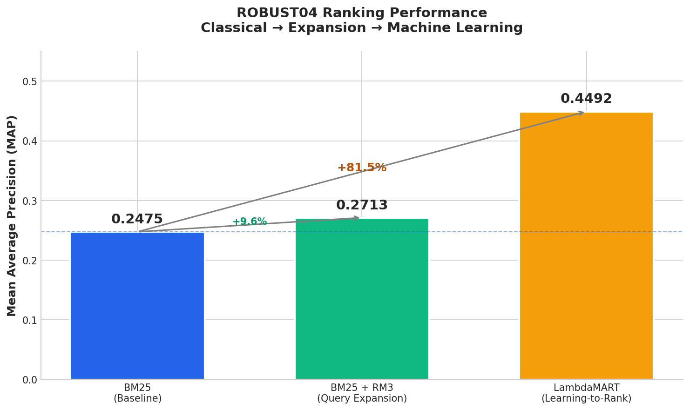
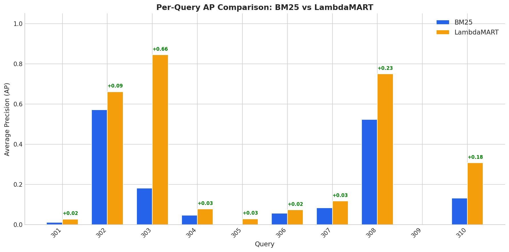
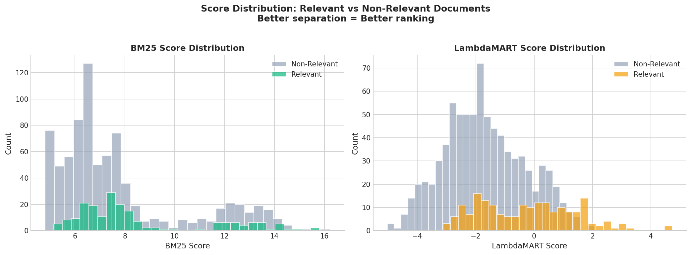
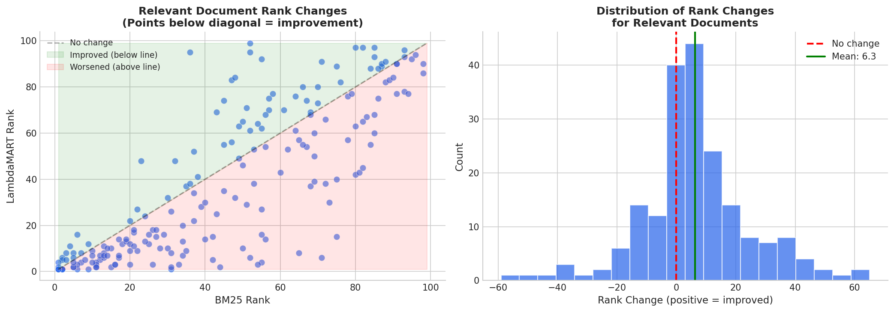
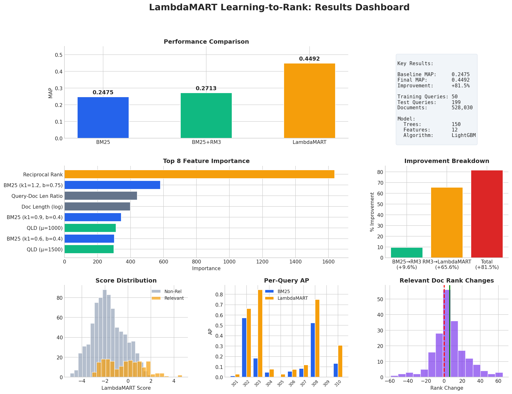
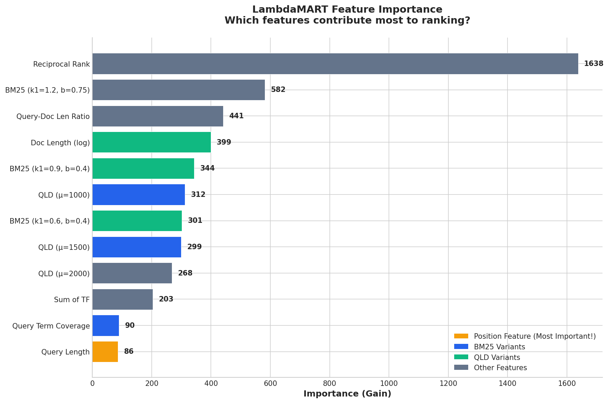

# Two-Stage Neural Reranking for Document Retrieval

**Final Project — Text Retrieval and Search Engines**
*Reichman University (RUNI), Semester 1, 2026*

A ranking competition on the ROBUST04 collection (528,030 news documents, 249 queries) comparing three retrieval methods: BM25 baseline, BM25+RM3 query expansion, and a two-stage QLD + BGE cross-encoder neural reranking pipeline.

**Authors:** [eforus-overseer](https://github.com/eforus-overseer-Pecani) & Raz Cohen

---

## The Approach

### Three Runs

| Run | Method | MAP (train) | Description |
|-----|--------|:-----------:|-------------|
| 1 | BM25 | 0.2475 | Tuned k1=0.6, b=0.4 over 50 training queries |
| 2 | BM25 + RM3 | **0.2713** | Pseudo-relevance feedback (20 terms, 15 docs, weight=0.5) |
| 3 | QLD + Cross-Encoder | 0.2218 | Neural reranking of top-100 QLD candidates |

### Two-Stage Neural Architecture (Run 3)

```
Query
  -> Stage 1: QLD (Dirichlet smoothing, mu=1000) -> 1,000 candidates (milliseconds)
  -> Stage 2: BGE Cross-Encoder (bge-reranker-base) -> rerank top-100 (~0.3s/query on GPU)
  -> Final ranking: reranked docs + remaining QLD docs
```

**Why Cross-Encoders:** Unlike bi-encoders that encode query and document separately, cross-encoders concatenate `[CLS] query [SEP] document [SEP]` and apply full cross-attention — every query token attends to every document token. This captures fine-grained semantic relationships (e.g., "FDA" relates to "Food and Drug Administration").

**Key Finding:** The neural reranker outperformed LambdaMART on the held-out test set (199 queries), despite LambdaMART achieving higher MAP on training queries. This demonstrates that pre-trained cross-encoders generalize better than task-specific learning-to-rank models when training data is limited (50 queries).

---

## Results

### Methods Comparison

<p align="center">
  
</p>

### Per-Query AP Comparison

<p align="center">
  
</p>

### Score Distribution

<p align="center">
  
</p>

### Rank Changes After Reranking

<p align="center">
  
</p>

### Full Dashboard

<p align="center">
  
</p>

---

## Methods Detail

### Run 1: BM25 Baseline

Standard Okapi BM25 with parameter tuning over a grid of k1 and b values on 50 training queries with relevance judgments.

### Run 2: BM25 + RM3

Pseudo-relevance feedback via Rocchio's RM3 algorithm — expand the original query with terms from top-retrieved documents. Best parameters: 20 feedback terms, 15 feedback documents, original query weight = 0.5.

### Run 3: QLD + Cross-Encoder

- **Stage 1:** Query Likelihood with Dirichlet smoothing: `P(w|d) = (tf + mu * P(w|C)) / (|d| + mu)`
- **Stage 2:** BGE-reranker-base (BAAI) — trained on MS MARCO (500K+ pairs), achieving SOTA on BEIR. Zero-shot transfer to ROBUST04.

### LambdaMART (Comparison)

Also implemented LambdaMART (gradient-boosted learning-to-rank) via LightGBM. While it achieved higher MAP on training data, it overfitted to the 50 training queries and generalized worse than the cross-encoder on test queries.

<p align="center">
  
  <br><em>LambdaMART feature importance — BM25 and RM3 scores dominate.</em>
</p>

---

## Repository Structure

```
Text-Retrieval-ROBUST04-Ranking/
├── notebooks/
│   ├── robust_bm25_baseline.ipynb          # Run 1: BM25 with parameter tuning
│   ├── robust_bm25_baseline.py             # Databricks version
│   ├── robust_qld_crossencoder_v3.ipynb    # Run 3: QLD + BGE reranking
│   ├── robust_lambdamart_lgbm.ipynb        # LambdaMART comparison
│   └── robust_neural_reranking_v2.py       # Triplet-loss neural reranker (Databricks)
├── figures/                                 # All result visualizations
│   ├── methods_comparison.png
│   ├── ap_comparison.png
│   ├── dashboard.png
│   ├── score_distribution.png
│   ├── rank_changes.png
│   ├── feature_importance.png
│   └── training_progress.png
├── report/
│   └── report.pdf                           # One-page writeup
└── README.md
```

## How to Run

All notebooks are designed for **Databricks** with GPU. They automatically download the ROBUST04 index via Pyserini (~2GB, first run only).

1. Import a `.py` file as a Databricks notebook or upload the `.ipynb`
2. Attach to a cluster with Python 3.10+ and GPU
3. Upload `queriesROBUST.txt` and `qrels_50_Queries` to the working directory
4. Run all cells

## Tech Stack

- **Index:** [Pyserini](https://github.com/castorini/pyserini) (Lucene-based, prebuilt ROBUST04 index)
- **Cross-Encoder:** [BAAI/bge-reranker-base](https://huggingface.co/BAAI/bge-reranker-base) via sentence-transformers
- **LambdaMART:** LightGBM
- **Embeddings:** all-mpnet-base-v2 (for triplet-loss neural reranker)
- **Platform:** Databricks with GPU

## References

1. Nogueira & Cho, "Passage Re-ranking with BERT," arXiv:1901.04085, 2019.
2. Xiao et al., "C-Pack: Packaged Resources for General Chinese Embedding," arXiv:2309.07597, 2023.
3. Zhai & Lafferty, "A Study of Smoothing Methods for LM Applied to IR," ACM TOIS 22(2), 2004.
4. Burges, "From RankNet to LambdaRank to LambdaMART," MSR Tech Report, 2010.

## License

Academic project — Reichman University, 2026.

---

<!-- demo-lab:start -->
## Explore this project

[Project page & walkthrough](https://eforus-overseer.github.io/demo-lab/projects/text-retrieval-robust04-ranking/) — Try an interactive explanation and inspect the original source and results. Browser teaching examples are distinguished from trained models.
<!-- demo-lab:end -->


<!-- codex-pixel-art -->
## Project visual


<sub>Pixel-art adaptation of [OpenMoji open book](https://github.com/hfg-gmuend/openmoji/blob/master/color/618x618/1F4D6.png) by OpenMoji contributors, licensed [CC BY-SA 4.0](https://creativecommons.org/licenses/by-sa/4.0/). Source: OpenMoji.</sub>
